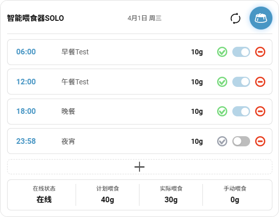

# PetKit 喂食器 Home Assistant 集成

[](https://github.com/hacs/integration)

[English](README_EN.md) | 简体中文

Home Assistant 原生集成，支持小佩智能喂食器的完整控制。

## 卡片预览



## 支持设备

| 设备               | 型号  | 状态         |
|--------------------|-------|--------------|
| Fresh Element Solo | D4    | ✅ 已支持    |
| Fresh Element      | D3    | 🚧 开发中    |
| Fresh Element Duo  | D4s   | 🚧 开发中    |
| Feeder Mini        | Mini  | 🚧 开发中    |

## 功能

- **喂食计划管理** - 新增/删除/修改计划，自动同步一周
- **喂食历史记录** - 追踪每次喂食详情
- **手动喂食** - 一键出粮
- **状态监控** - 在线状态、WiFi 信号、干燥剂状态
- **美观卡片** - 专为 Lovelace 设计的可视化界面

## 安装

### HACS 安装（推荐）

1. HACS → 集成 → 探索并下载仓库
2. 添加自定义仓库：`https://github.com/ningjx/petkit-feeder.git`
3. 搜索 "小佩喂食器" 或 "Petkit Feeder"
4. 点击下载并重启 Home Assistant
5. 设置 → 设备与服务 → 添加集成 → 搜索 "小佩喂食器"

### 手动安装

1. 从 GitHub Releases 下载 `petkit_feeder.zip`
2. 将 ZIP 内容解压到 Home Assistant 的 `custom_components/petkit_feeder` 目录
3. 重启 Home Assistant
4. 设置 → 设备与服务 → 添加集成 → 搜索 "小佩喂食器"

## Lovelace 卡片

卡片随集成发布。Home Assistant 启动时会为存储模式的仪表盘资源自动注册卡片，随后在仪表盘中添加即可。

如果之前安装过独立卡片，请在升级时卸载独立卡片或移除旧的 JS 资源，再重启 Home Assistant。已有卡片配置可以继续使用。

如果仪表盘资源由 YAML 管理，请在 `lovelace.resources` 中添加 `/petkit_feeder/petkit-feeder-card.js`，类型设为 `module`。

```yaml
type: custom:petkit-feeder-card
device_id: "YOUR_DEVICE_ID"
```

> 💡 **提示**：`device_id` 可在集成设备页面的「设备 ID」传感器中获取。

## 鸣谢

本项目基于 [py-petkit-api](https://github.com/Jezza34000/py-petkit-api) 开发，感谢原作者的贡献。

## 注意

- 本项目非小佩官方产品
- API 可能随时变更

## 许可证

MIT
