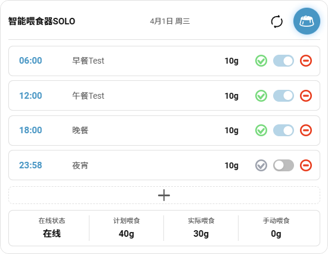

# PetKit Feeder Home Assistant Integration

[](https://github.com/hacs/integration)

English | [简体中文](README.md)

Native Home Assistant integration for PetKit smart feeders.

## Card Preview



## Supported Devices

| Device             | Model | Status           |
|--------------------|-------|------------------|
| Fresh Element Solo | D4    | ✅ Supported     |
| Fresh Element      | D3    | 🚧 In Development|
| Fresh Element Duo  | D4s   | 🚧 In Development|
| Feeder Mini        | Mini  | 🚧 In Development|

## Features

- **Feeding Schedule Management** - Add/delete/modify schedules, auto-sync weekly
- **Feeding History** - Track every feeding detail
- **Manual Feeding** - One-click feeding
- **Status Monitoring** - Online status, WiFi signal, desiccant status
- **Beautiful Card** - Custom Lovelace card for visualization

## Installation

### HACS Installation (Recommended)

1. HACS → Integrations → Explore and download repositories
2. Add custom repository: `https://github.com/ningjx/petkit-feeder.git`
3. Search for "Petkit Feeder"
4. Click download and restart Home Assistant
5. Settings → Devices & Services → Add Integration → Search for "Petkit"

### Manual Installation

1. Download `petkit_feeder.zip` from GitHub Releases
2. Extract the ZIP contents into `custom_components/petkit_feeder` in your Home Assistant configuration directory
3. Restart Home Assistant
4. Settings → Devices & Services → Add Integration → Search for "Petkit"

## Lovelace Card

The card ships with the integration. Home Assistant registers it on startup when dashboard resources are managed in storage mode. You can then add it to your dashboard.

If you installed the standalone card, uninstall it or remove its old JavaScript resource when upgrading, then restart Home Assistant. Existing dashboard card configurations continue to work.

If you manage dashboard resources in YAML, add `/petkit_feeder/petkit-feeder-card.js` to `lovelace.resources` as a `module`.

```yaml
type: custom:petkit-feeder-card
device_id: "YOUR_DEVICE_ID"
```

> 💡 **Tip**: The `device_id` can be found in the "Device ID" sensor on the integration device page.

## Credits

This project is based on [py-petkit-api](https://github.com/Jezza34000/py-petkit-api). Thanks to the original author.

## Disclaimer

- This is not an official PetKit product
- API may change at any time

## License

MIT
