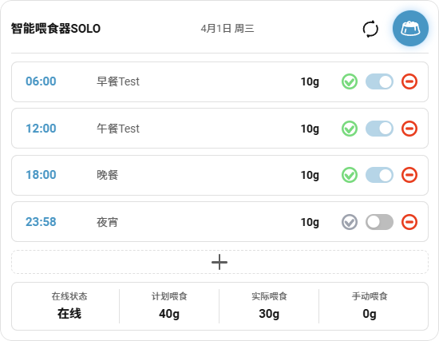

# PetKit 喂食器 Lovelace 卡片

[English](README_EN.md) | 简体中文

专为 PetKit 智能喂食器设计的 Home Assistant Lovelace 卡片。

## 卡片预览



## 功能

- **喂食计划管理** - 可视化管理一周喂食计划，支持新增、编辑、删除
- **喂食历史记录** - 追踪每次喂食详情，显示计划喂食量与实际进食量
- **手动喂食** - 一键出粮，快速补充喂食
- **状态监控** - 实时显示设备在线状态、WiFi 信号、干燥剂状态
- **周视图切换** - 快速切换查看不同日期的喂食计划

## 交互

| 操作         | 效果           |
|--------------|----------------|
| 点击时间     | 编辑时间       |
| 点击名称     | 编辑名称       |
| 点击克数     | 编辑出粮量     |
| 点击开关     | 启用/禁用计划  |
| 点击删除     | 删除计划       |
| 失焦         | 自动保存       |
| ESC          | 取消编辑       |
| 点击虚线框   | 新增计划       |

## 前置要求

1. 已安装 Home Assistant（2024.1.0 或更高版本）
2. 已安装 [PetKit 喂食器集成](../README.md)
3. 已配置好 PetKit 喂食器设备

## 安装

卡片随 [PetKit 喂食器集成](../README.md#安装) 发布。安装集成并重启 Home Assistant 后，即可添加下方的卡片配置。独立卡片迁移和 YAML 资源配置见[主仓库说明](../README.md#lovelace-卡片)。

## 配置

```yaml
type: custom:petkit-feeder-card
device_id: "YOUR_DEVICE_ID"
```

> 💡 **提示**：`device_id` 可在 Home Assistant 集成设备的「设备 ID」传感器中获取。

### 配置选项

| 参数             | 类型    | 必需 | 默认     | 说明               |
|------------------|---------|------|----------|--------------------|
| `device_id`      | string  | 是*  | -        | 设备 ID            |
| `entity`         | string  | 否   | 自动推断 | 喂食计划传感器     |
| `history_entity` | string  | 否   | 自动推断 | 历史记录传感器     |
| `name`           | string  | 否   | 设备名   | 卡片标题           |
| `show_timeline`  | bool    | 否   | true     | 显示时间线         |
| `show_summary`   | bool    | 否   | true     | 显示统计           |
| `show_actions`   | bool    | 否   | true     | 显示操作按钮       |

*`device_id` 和 `entity` 二选一必填

## 支持设备

| 设备               | 型号  | 状态         |
|--------------------|-------|--------------|
| Fresh Element Solo | D4    | ✅ 已支持    |
| Fresh Element      | D3    | 🚧 暂不支持  |
| Fresh Element Duo  | D4s   | 🚧 暂不支持  |
| Feeder Mini        | Mini  | 🚧 暂不支持  |

## 开发

从仓库根目录进入卡片目录，使用 Node.js 24 构建。

```bash
cd petkit_feeder_card
npm ci --ignore-scripts
npm run build
```

产物位于 `dist/petkit-feeder-card.js`。用 `npm start` 可以在修改源码时重新构建。

## 注意

- 本项目非小佩官方产品
- API 可能随时变更

## 许可证

MIT
